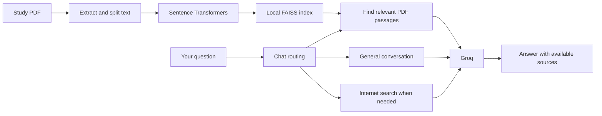

<p align="center">
  
</p>

<p align="center">
  <strong>A focused place to study your PDFs, ask questions, practise and plan.</strong>
</p>

<p align="center">
  
  
  
  
  
</p>

<p align="center">
  <a href="#what-you-can-do">Features</a> ·
  <a href="#how-it-works">How it works</a> ·
  <a href="#run-locally">Setup</a> ·
  <a href="#testing">Testing</a> ·
  <a href="#current-limits">Limits</a>
</p>

---

## Why Clariqo?

Study material often sits in one place, practice questions in another, and revision plans somewhere else. Clariqo brings them together in a Python web app: upload your notes, ask for an explanation, test your understanding, and plan your next study session.

Built as a hackathon prototype, it combines **retrieval-augmented generation (RAG)** with chat, quizzes and saved learning progress. It runs locally and uses Groq for AI responses.

## What you can do

| Area | What it offers |
| --- | --- |
| **Dashboard** | An overview of your study activity and shortcuts to the main tools. |
| **Study Materials** | Upload text-based PDFs up to **20 MB**, then select, preview, download and reuse saved files. |
| **Ask AI** | Chat normally, ask questions about a selected PDF with page references, or request an internet search. PDF-only mode keeps the answer scoped to your material. |
| **Quiz** | Generate **5 or 10 questions**, choose Easy, Medium or Hard, and review scores, explanations and weak areas. |
| **My Progress** | Review saved quiz performance and identify topics that need more practice. |
| **Study Plan** | Create a plan of up to **14 days** using your subject, exam date, level, available time and optional PDF material. Track completed days and download the plan. |

Chat history, quiz results, the current study plan and completed study days are saved locally.

## How it works



**For PDF questions**, Sentence Transformers converts the question and text passages into numerical embeddings. FAISS finds passages with a similar meaning, and the model uses those passages to form an answer with page references. Uploading a PDF does **not** train the model.

**For general chat**, the app uses conversation history. When online information is needed, it can use the configured model's browser-search tool and show returned source links. Quizzes and plans use the selected material when provided; progress is stored as local JSON.

## Tech stack

| Layer | Technology |
| --- | --- |
| Interface | Streamlit, custom HTML and CSS |
| Application logic | Python 3.11 |
| AI responses | Groq API; configured default: `openai/gpt-oss-120b` |
| Text embeddings | Sentence Transformers: `all-MiniLM-L6-v2` |
| Similarity search | FAISS |
| PDF extraction and preview | pypdf and pypdfium2 |
| Storage | Local PDFs, FAISS index and JSON learning state |
| Tests | Python unittest, mocks and Streamlit AppTest |

The model named above is accessed **through Groq**, not through the OpenAI API. The code also retains an optional legacy Gemini path; the verified setup uses Groq.

## Run locally

### 1. Get the project

```sh
git clone https://github.com/chaitanya9560/Clariqo.git
cd Clariqo
```

### 2. Install dependencies

**Verified setup: Python 3.11 on an Intel Mac.**

```sh
python3.11 -m venv .venv
source .venv/bin/activate
python -m pip install -r requirements-local-mac.lock.txt
```

For other platforms, `requirements.txt` lists the general dependencies. Those installations need their own compatibility check; the Intel Mac lock file is not a cross-platform lock file.

### 3. Configure your API key

```sh
cp .env.example .env
```

Edit `.env` locally:

```dotenv
AI_PROVIDER=groq
GROQ_API_KEY=paste_your_groq_key_here
GROQ_MODEL=openai/gpt-oss-120b
```

Use your own Groq key. Keep it in `.env`; never paste it into an issue or commit it. Provider availability, free-tier eligibility and rate limits depend on your account. Clariqo does not enable billing.

### 4. Start Clariqo

```sh
python -m streamlit run app.py --server.address 127.0.0.1 --server.port 8501
```

Open **http://127.0.0.1:8501/** in your browser. Keep the server running while you use the app. The embedding model downloads on first use, so an internet connection is required.

### Try a complete study session

1. Upload `tests/fixtures/cloud_computing_sample.pdf` in **Study Materials**.
2. Select it and ask a question in **Ask AI**.
3. Generate a quiz, submit your answers and review the explanations.
4. Check **My Progress** for your recorded score.
5. Create a **Study Plan** with a future exam date and mark a day complete.

## Project layout

```text
Clariqo/
├── app.py                  # Local app: pages and navigation
├── cloud/                  # Public cloud entrypoint and Linux dependencies
├── cloud_app.py            # Bind a private workspace to each browser session
├── workspace.py            # Visitor storage, context and demo limits
├── ui_components.py        # Styling and display helpers
├── config.py               # Provider settings and API requests
├── study_chat.py           # Conversation and question routing
├── rag.py                  # PDF processing and semantic retrieval
├── study_uploads.py        # Safe PDF replacement
├── quiz.py                 # Quiz generation and grading
├── study_plan.py           # Plan generation and day parsing
├── tools.py                # Study tool routing
├── memory.py               # Saved learning state and recovery
├── tests/                  # Automated checks and synthetic fixtures
├── docs/                   # Documentation and visual assets
├── .github/                # Contribution and issue templates
├── .streamlit/             # App configuration
├── .env.example            # Key placeholders; no real secrets
├── uploads/                # Local study PDFs; contents ignored
└── data/                   # Local learning state and search index; ignored
```

## Testing

From the project root, with the virtual environment active:

```sh
python -m unittest discover -s tests -v
```

The latest local check passed **134 automated tests**, including regression and visitor-isolation checks. This is a recorded local result, not a hosted CI status. The suite uses temporary data, synthetic PDF fixtures and mocked AI calls; it does not need your real key or personal PDFs, and it does not prove live model availability or answer accuracy.

For a structured test report and function-call inventory:

```sh
python tests/run_deep_audit.py
```

Generated reports are written to `test_results/` and excluded from Git.

## Public demo deployment

Use the dedicated **`cloud/app.py`** entrypoint on Streamlit Community Cloud, with **Python 3.11**. Its adjacent `cloud/requirements.txt` selects Linux CPU dependencies rather than the Intel Mac lock file.

Each browser session gets a separate temporary PDF folder, FAISS index, chat and learning history. Only the embedding model is shared. This is **session isolation, not student accounts**: a disconnected or new session and server restarts can lose that temporary work. The original `app.py` remains the local, saved-profile version.

The public demo caps each session at 5 PDFs / 50 MB combined; individual files remain limited to 20 MB, 200 pages and 300,000 extracted text characters. It also caps AI calls at 60 per hour per session; routing and answering can use separate calls. These are basic demo limits, not abuse-proof controls or a provider quota guarantee.

Follow [the deployment guide](docs/DEPLOYMENT.md) for hosting fields and secrets. Never upload your local `.env` or personal PDFs to deploy.

## Data and privacy

- Uploaded PDFs stay in `uploads/`; the search index stays in `data/vector_store/`.
- Chat, plans and learning progress are saved in `data/memory.json`.
- Relevant document excerpts and prompts are sent to Groq when you use AI features. Local storage does not mean offline AI processing.
- The internet-search route sends a standalone search query rather than the full PDF or conversation history.
- API keys, personal uploads, saved learning data, model caches and generated reports are excluded from Git.

Memory writes are atomic. On handled PDF-replacement failures, the original document and index are preserved. This is a local prototype, not a production data platform.

## Current limits

- **No student accounts:** local mode uses one saved profile; cloud demo mode separates temporary browser sessions. There is no cross-device sync.
- **Text PDFs:** scanned pages need OCR, which is not included. Equations and complex layouts may extract imperfectly.
- **AI accuracy:** generated answers, questions and plans can contain mistakes; source links do not guarantee correctness.
- **Context limits:** long study material may only be included partially. Vague follow-up questions in PDF-only mode can miss the intended passage.
- **Planning:** existing plans do not automatically rebuild after a new quiz.
- **Connectivity:** AI responses and web search need internet access and provider availability.

## Future improvements

These are planned ideas, **not current features**:

- OCR for scanned study material.
- Student accounts and a database for separate learning profiles.
- Study plans that adapt after new quiz results.
- Broader platform and deployment verification.

## Contributing and feedback

Found a problem or have an idea? Use the [bug report](https://github.com/chaitanya9560/Clariqo/issues/new?template=bug_report.yml) or [feature request](https://github.com/chaitanya9560/Clariqo/issues/new?template=feature_request.yml) form. See [CONTRIBUTING.md](.github/CONTRIBUTING.md) for local checks and [SECURITY.md](.github/SECURITY.md) for handling sensitive reports.

## Acknowledgements and licensing

Clariqo began from [ug8yogesh/AI-Learning-Study-Assistant](https://github.com/ug8yogesh/AI-Learning-Study-Assistant) and has been modified for this prototype. The downloaded upstream source did not include a license file. This repository does not assert a new license for that source; public availability alone does not grant reuse rights.
