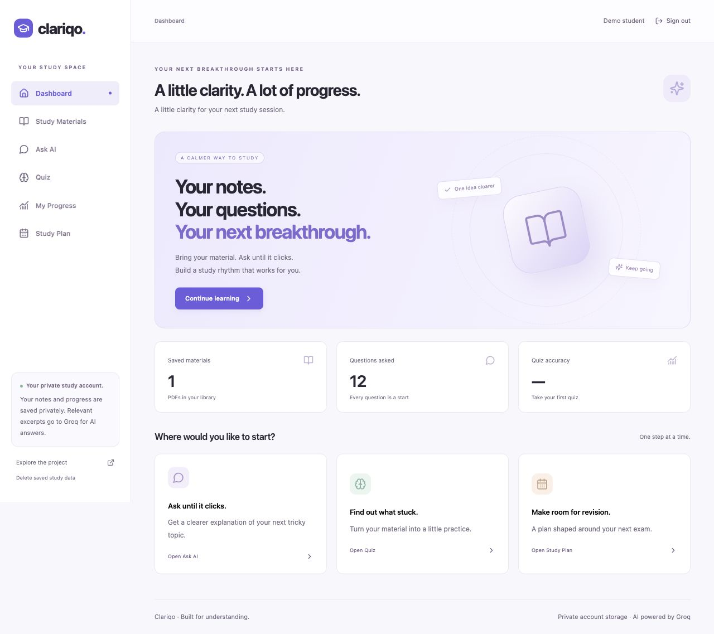
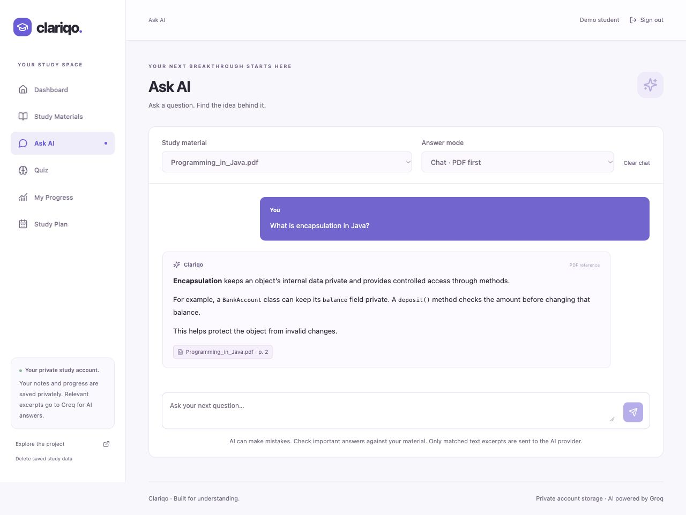
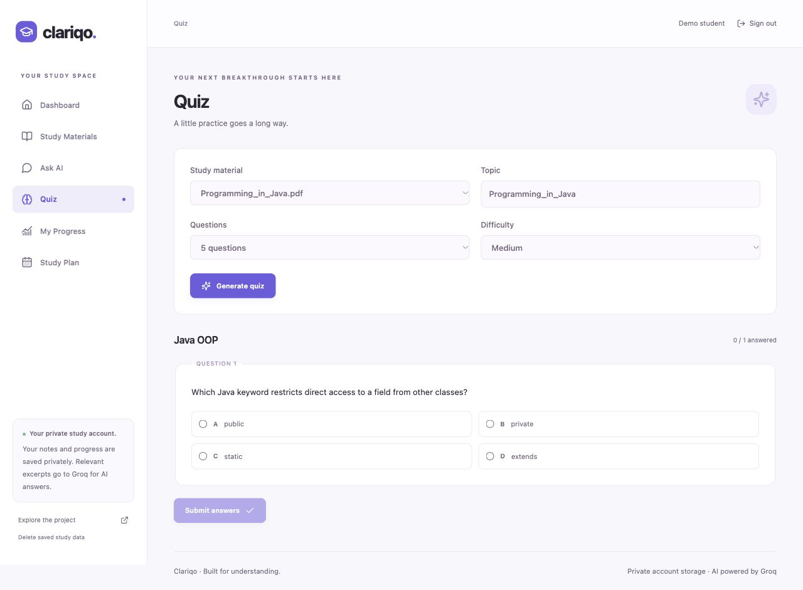
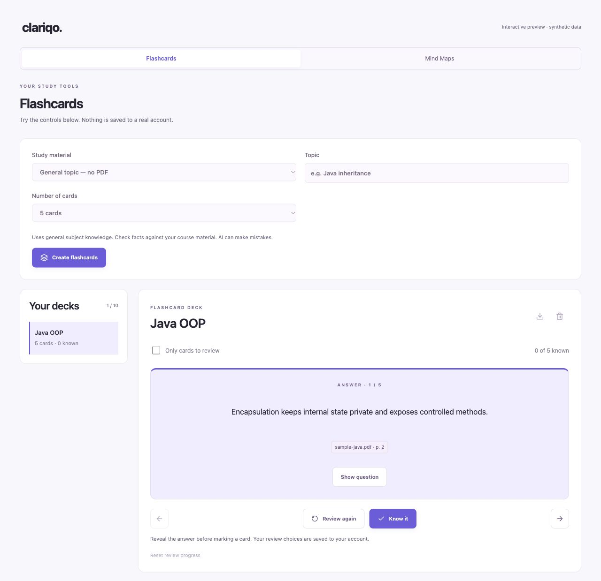
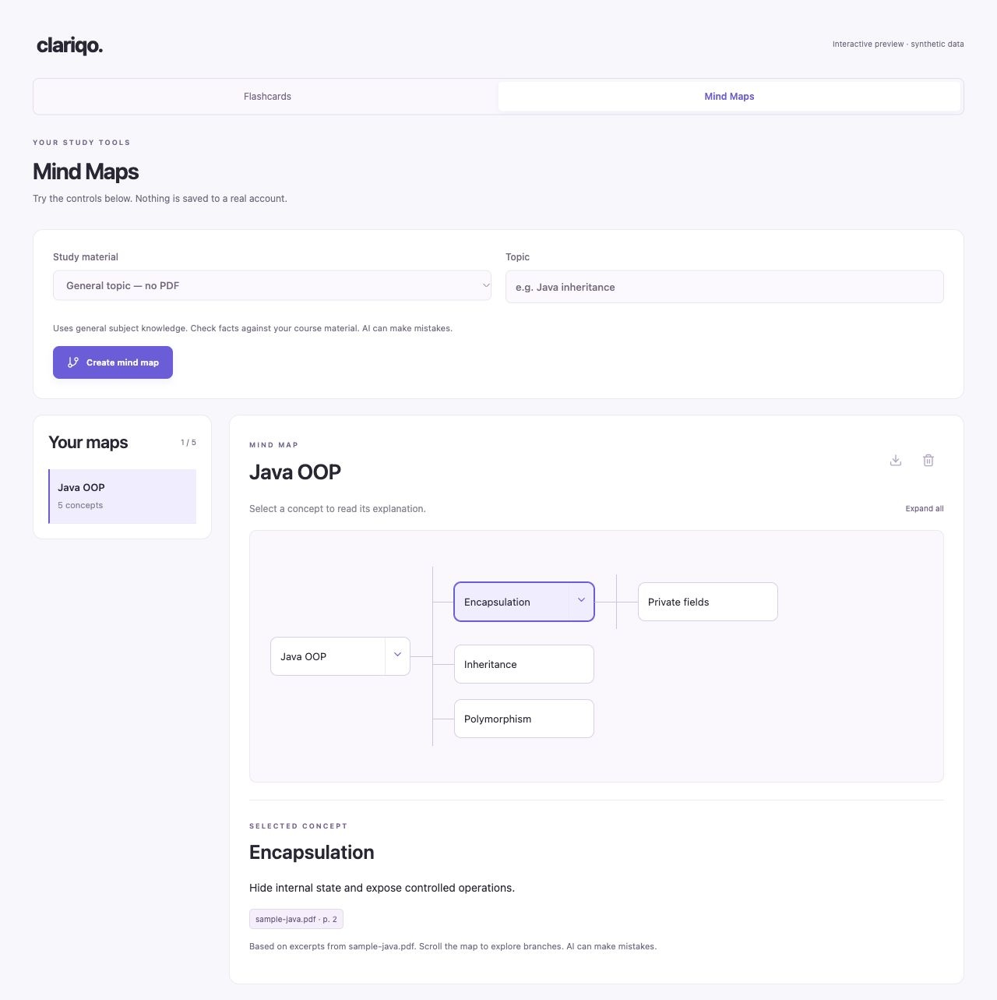
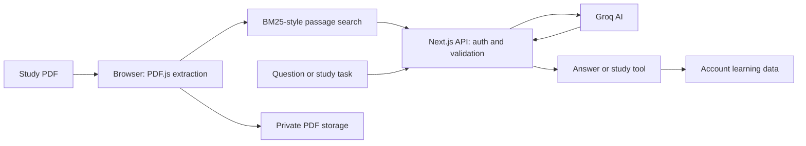

<p align="center">
  
</p>
<p align="center"><strong>Your course material. Clear explanations. Better practice.</strong></p>
<p align="center">An AI study workspace for reading PDFs, asking questions and planning revision.</p>
<p align="center">
  <a href="https://clariqo.vercel.app/">Open Clariqo</a> ·
  <a href="#quick-start">Run locally</a> ·
  <a href="docs/DEPLOYMENT.md">Deploy</a> ·
  <a href="https://github.com/chaitanya9560/Clariqo/issues/new/choose">Report an issue</a>
</p>
<p align="center">
  
  
  
  
  
</p>

## What is Clariqo?

Clariqo brings study material, explanations and revision tools into one website. Upload a PDF, ask about a concept, practise with a quiz, then revisit difficult topics through flashcards, mind maps or a study plan.

The current application is a full-stack **Next.js** website in `web/`. **React** powers the interface, **Node.js API routes** handle AI requests, **Groq** generates content, and **Supabase** handles account access and private saved data.

<p align="center"></p>

*Interface previews use synthetic study content. They show the purple design; some labels may differ from the latest release.*

## Study features

| Feature | What it does |
| --- | --- |
| **PDF library** | Upload text PDFs up to 20 MB, preview, download and reuse saved material. |
| **Ask AI** | Chat normally, ask PDF-only questions or search the internet with returned source links. |
| **Quizzes** | Generate 5 or 10 questions, choose difficulty, review explanations and save scores. |
| **Flashcards** | Reveal answers, mark cards for review and keep progress in saved decks. |
| **Mind maps** | Explore expandable concepts, read explanations and download an outline. |
| **Progress** | See quiz accuracy and subtopics that need more practice. |
| **Study plans** | Plan up to 14 days using the exam date, available hours, level and relevant weak topics. |
| **Private accounts** | Sign in with verified email/password and keep PDFs and learning data tied to your account. |

<table>
  <tr>
    <td width="50%"><strong>Ask AI</strong><br></td>
    <td width="50%"><strong>Quiz practice</strong><br></td>
  </tr>
</table>

<details>
<summary><strong>See flashcards and mind maps</strong></summary>

<table>
  <tr>
    <td width="50%"><strong>Flashcards</strong><br></td>
    <td width="50%"><strong>Mind maps</strong><br></td>
  </tr>
</table>

</details>

## How it works



1. **Read:** PDF.js extracts selectable text in the browser and keeps page references.
2. **Find:** BM25-style keyword scoring selects relevant passages for a PDF question.
3. **Generate:** A Node.js API route checks the request and calls Groq with bounded context.
4. **Study:** The website displays the answer, quiz, cards, map or plan. Account data is saved under ownership policies.

The Groq key stays on the server. Original PDFs upload directly to private Supabase Storage; selected excerpts go to Groq for PDF-based generation. Search-enabled requests use the current question without the PDF excerpts or chat history. The current version uses lexical retrieval rather than FAISS or an embedding runtime.

## Tech stack

| Layer | Tools |
| --- | --- |
| Frontend | Next.js App Router, React, TypeScript, CSS, Lucide icons |
| Backend | Next.js API routes on Node.js, Zod validation |
| AI | Groq API, configured server-side model |
| PDF and search | PDF.js, browser-local BM25-style retrieval |
| Formatted answers | React Markdown, KaTeX |
| Accounts and data | Supabase Auth, PostgreSQL, private Storage |
| Development and hosting | Git, GitHub, Vercel |

## Quick start

Use **Node.js 22 or 24** and npm.

```sh
git clone https://github.com/chaitanya9560/Clariqo.git
cd Clariqo/web
npm ci
cp .env.example .env.local
```

Fill in `.env.local` using your own settings:

| Variable | Purpose |
| --- | --- |
| `GROQ_API_KEY` | Server-only Groq API key |
| `GROQ_MODEL` | Model name; the example uses `openai/gpt-oss-120b` |
| `NEXT_PUBLIC_SUPABASE_URL` | Browser-safe Supabase project URL |
| `NEXT_PUBLIC_SUPABASE_PUBLISHABLE_KEY` | Browser-safe publishable key |
| `DEMO_ACCESS_CODE` | Optional additional code for controlled demos |

Follow the [account setup guide](docs/EMAIL_LOGIN.md) to configure the database, private storage and verified email access. Never use a service-role key in the browser or prefix the Groq key with `NEXT_PUBLIC_`.

```sh
npm run dev
```

Open **http://localhost:3000**. Production hosting instructions are in the [deployment guide](docs/DEPLOYMENT.md).

> **Vercel settings:** branch `main` · root directory `web` · framework Next.js. Add the real environment values in Vercel; private `.env` files are not committed.

## Project structure

```text
Clariqo/
├── web/
│   ├── app/             # Pages, styles and server routes
│   ├── components/      # Chat, quizzes and study tools
│   ├── lib/             # Retrieval, AI, storage and validation
│   ├── tests/           # Automated tests and manual checks
│   ├── .env.example     # Placeholder settings
│   └── package-lock.json
├── supabase/migrations/ # Account-data and file-access policies
├── docs/                # Setup, feature notes and reviews
└── .github/             # Contribution, security and issue guides
```

## Checks and current limits

Run from `web/`:

```sh
npm run typecheck
npm test
npm run build
```

The final source handoff passed **127 automated tests** and TypeScript checks. The previous production build also passed. These are source checks, not a guarantee of AI accuracy or complete signed-in browser coverage. See the [handoff](docs/FINAL_SOURCE_HANDOFF.md) and [latest full review](docs/WEBSITE_REVIEW_AFTER_FOUR_FIXES_2026-10-31.md) for the exact checks and remaining issues.

- Text-based PDFs only; scanned documents need OCR, which is not included.
- Five PDFs / 50 MB total; each PDF is limited to 20 MB, 200 pages and 300,000 extracted characters.
- Plans cover up to 14 days. Card review uses self-ratings, not automatic spaced repetition.
- Keyword retrieval can miss paraphrases and equations. AI explanations and quiz keys can be wrong.
- Provider and hosting quotas apply. Internet mode needs working search support; unlimited use is not promised.
- File and database deletion are separate operations; interrupted deletion can require recovery.
- Failed saves offer retry and a JSON backup. Unsaved changes can still be lost if the page is closed.
- Google sign-in is deferred. Email delivery and full account flows still need checks for each new deployment.

## Guides and feedback

[Local setup](web/README.md) · [Deployment](docs/DEPLOYMENT.md) · [Email accounts](docs/EMAIL_LOGIN.md) · [Study tools](docs/STUDY_TOOLS.md) · [Contributing](.github/CONTRIBUTING.md) · [Security](.github/SECURITY.md)

Found a problem? [Open an issue](https://github.com/chaitanya9560/Clariqo/issues/new/choose) with clear steps and a screenshot, with private details removed.

## Credit and project history

Clariqo began from [ug8yogesh/AI-Learning-Study-Assistant](https://github.com/ug8yogesh/AI-Learning-Study-Assistant). The earlier Python/Streamlit prototype is preserved in [Git history](https://github.com/chaitanya9560/Clariqo/tree/bb4cc2a); the current branch contains the Next.js implementation.

The downloaded upstream source had no license file. This repository retains that credit and does not assert a new license for the upstream code.
