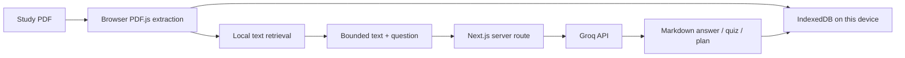

<p align="center"></p>
<p align="center"><strong>Your notes. Your questions. Your next breakthrough.</strong></p>
<p align="center">


</p>

## Vercel migration branch

This branch contains a working Next.js version of Clariqo under **`web/`**. The original Python/Streamlit version is preserved on [`main`](https://github.com/chaitanya9560/Clariqo/tree/main).

**Vercel import settings:** repository `chaitanya9560/Clariqo` · branch `vercel-migration` · root directory **`web`** · framework **Next.js**.

Read the [complete setup and deployment guide](web/README.md) before deploying. Set `GROQ_API_KEY` and `GROQ_MODEL` in Vercel's server environment variables; never expose the key through a `NEXT_PUBLIC_` variable.

## What you can do

| Page | Features |
| --- | --- |
| Dashboard | Saved materials, question count and quiz accuracy |
| Study Materials | Read PDFs up to 20 MB, select, preview, download and reuse them |
| Ask AI | Normal conversation, PDF-first answers, PDF-only mode and internet search |
| Quiz | 5 or 10 questions, difficulty, explanations and scored answers |
| My Progress | Saved quiz scores and subtopics that need more practice |
| Study Plan | Up to 14 days, exam date, study time, level, weak topics and a completion checklist |

PDFs, chat, quiz results and the current plan are saved **in the visitor's browser**. There are no logins or cross-device sync.

## Architecture



This branch uses browser-local BM25-style text retrieval, **not FAISS or Sentence Transformers**. That avoids loading a Python embedding runtime into Vercel Functions. The original PDF stays in the browser; selected excerpts and prompts go to Groq through a server-only API key. PDF-only answers use supplied page references. Web fallback does not send the PDF or chat history to the search-enabled request.

## Run locally

```sh
git clone --branch vercel-migration https://github.com/chaitanya9560/Clariqo.git
cd Clariqo/web
npm ci
cp .env.example .env.local
```

Add your Groq key to `.env.local`, then run `npm run dev` and open http://localhost:3000.

## Verification

```sh
cd web
npm run typecheck
npm test
npm run build
```

The latest local check passed **46 automated tests**, strict TypeScript checks and a production build. Live Groq chat, PDF-context answers, quizzes, structured plans and internet search also passed. The production dependency audit reported no vulnerabilities at the time of the check.

Browser visual checks and real browser PDF extraction remain unverified because browser control was disabled. See the [verification report](docs/VERCEL_VERIFICATION.md) and [web guide](web/README.md) for the boundaries of these checks.

## Project structure

```text
web/
├── app/                 # Next.js pages, styles and server API
├── components/          # Interactive six-page study interface
├── lib/                 # PDF reading, storage, retrieval, AI and validation
├── tests/               # Domain, API and browser-storage tests
├── .env.example         # Placeholder server settings
└── package-lock.json    # Reproducible Node dependencies
```

The Python files at the repository root remain available for the earlier local/Streamlit app. Vercel builds only the selected `web` root; it does not install the Python requirements.

## Limits and privacy

Text-based PDFs only; no OCR. Text retrieval can miss paraphrases and equations. AI output can be wrong. Browser storage belongs to the browser profile, so people sharing that profile also share its saved study data. Clearing site data removes saved work. Provider quotas and hosting limits apply; unlimited usage and durable accounts are not implemented. A shared demo access code is optional; rate limits are best-effort across serverless instances.

## Feedback and credit

Use the [issue forms](https://github.com/chaitanya9560/Clariqo/issues/new/choose) for bugs or ideas. Remove private study material and credentials before posting.

Clariqo began from [ug8yogesh/AI-Learning-Study-Assistant](https://github.com/ug8yogesh/AI-Learning-Study-Assistant). The downloaded upstream source had no license file, and this repository does not assert a new license for that code. The Vercel migration is separate from the original implementation and retains that project credit.
