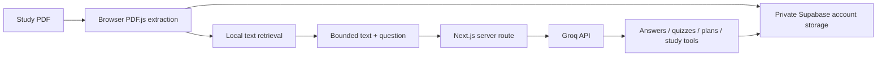

<p align="center"></p>
<p align="center"><strong>Your notes, questions and revision, together.</strong></p>
<p align="center">


</p>

## Current website

The current project contains the Next.js website under **`web/`**. The earlier Python/Streamlit prototype is preserved in [Git history](https://github.com/chaitanya9560/Clariqo/tree/bb4cc2a).

**Vercel import settings:** repository `chaitanya9560/Clariqo` · branch `main` · root directory **`web`** · framework **Next.js**.

Read the [complete setup and deployment guide](web/README.md) before deploying. Set `GROQ_API_KEY` and `GROQ_MODEL` in Vercel's server environment variables; never expose the key through a `NEXT_PUBLIC_` variable.

## What you can do

| Page | Features |
| --- | --- |
| Dashboard | Saved documents, study-plan days, practice topics and account totals |
| Study Materials | Read PDFs up to 20 MB, select, preview, download and reuse them |
| Ask AI | Normal conversation, PDF-first answers, PDF-only mode and internet search |
| Quiz | 5 or 10 questions, difficulty, explanations and scored answers |
| Flashcards | Saved 5- or 10-card decks, answer reveal and review progress |
| Mind Maps | Expandable concept trees, explanations, PDF references and outline downloads |
| My Progress | Saved quiz scores and subtopics that need more practice |
| Study Plan | Up to 14 days, exam date, study time, level, weak topics and a completion checklist |

Email/password sign-in requires email verification. PDFs are saved in private Supabase Storage; chat, quiz results, plans, flashcards and mind maps are saved to the signed-in account. Google sign-in is deferred. Custom SMTP is configured. Real inbox delivery still needs a sign-up check.

## Architecture



This branch uses browser-local BM25-style text retrieval, **not FAISS or Sentence Transformers**. That avoids loading a Python embedding runtime into Vercel Functions. The original PDF is extracted in the browser and saved directly to private Supabase Storage; selected excerpts and prompts go to Groq through a server-only API key. PDF-only answers use supplied page references. Web fallback does not send the PDF or chat history to the search-enabled request.

## Run locally

```sh
git clone --branch main https://github.com/chaitanya9560/Clariqo.git
cd Clariqo/web
npm ci
cp .env.example .env.local
```

Add your Groq key and Supabase publishable configuration to `.env.local` (see the [account setup guide](docs/EMAIL_LOGIN.md)), then run `npm run dev` and open http://localhost:3000.

## Verification

```sh
cd web
npm run typecheck
npm test
npm run build
```

The final source passes **127 automated tests** and strict TypeScript checks. The last production build also passed; the cleanup removed only the older Python app and generated files. Real Groq tests covered PDF flashcards, general-topic flashcards and a 12-concept mind map with validated excerpt references. Browser review covered desktop/mobile UI previews and local login controls. Existing account records remain compatible with the optional new study-tool fields.

These checks do not guarantee factual correctness of AI content. Full signed-in browser testing and inbox delivery were not repeated for this release. Internet search was not re-certified in this pass because earlier diagnostics hit provider limits. The last Supabase advisor check flagged disabled leaked-password protection, which requires a paid plan; this project remains on Free. See the [website audit](docs/WEBSITE_TEST_2026-10-31.md), [UI review](docs/STUDY_DESK_UI.md) and [study-tool notes](docs/STUDY_TOOLS.md) for test boundaries.

## Project structure

```text
web/
├── app/                 # Next.js pages, styles and server API
├── components/          # Interactive eight-page study interface
├── lib/                 # PDF reading, storage, retrieval, AI and validation
├── tests/               # Domain, API and browser-storage tests
├── .env.example         # Placeholder server settings
└── package-lock.json    # Reproducible Node dependencies
```

The old Python source, requirements and tests have been removed from this branch. Vercel builds the `web` root. Database migrations remain under `supabase/`, and setup and review notes remain under `docs/`.

## Limits and privacy

Text-based PDFs only; no OCR. Text retrieval can miss paraphrases and equations. AI output can be wrong. Account data is protected with database and storage ownership policies. Sign out on shared devices. Old browser-only data is kept in IndexedDB and is not automatically copied into an account. Provider and Supabase quotas apply; unlimited usage is not promised. Storage and database deletions are separate operations; retry if a network failure interrupts clearing data. A shared demo access code is optional; rate limits are best-effort across serverless instances.

## Feedback and credit

Use the [issue forms](https://github.com/chaitanya9560/Clariqo/issues/new/choose) for bugs or ideas. Remove private study material and credentials before posting.

Clariqo began from [ug8yogesh/AI-Learning-Study-Assistant](https://github.com/ug8yogesh/AI-Learning-Study-Assistant). The downloaded upstream source had no license file, and this repository does not assert a new license for that code. The Vercel migration is separate from the original implementation and retains that project credit.
